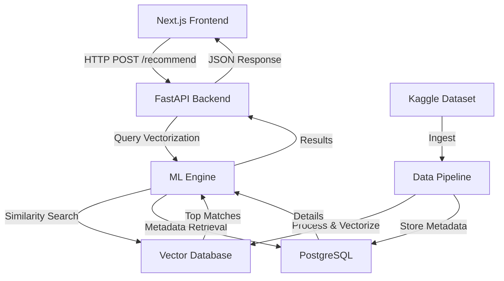
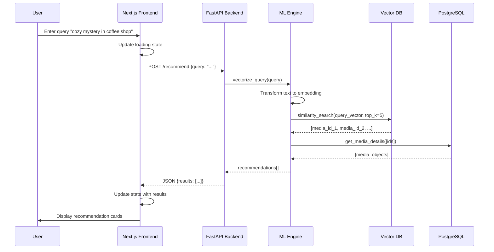
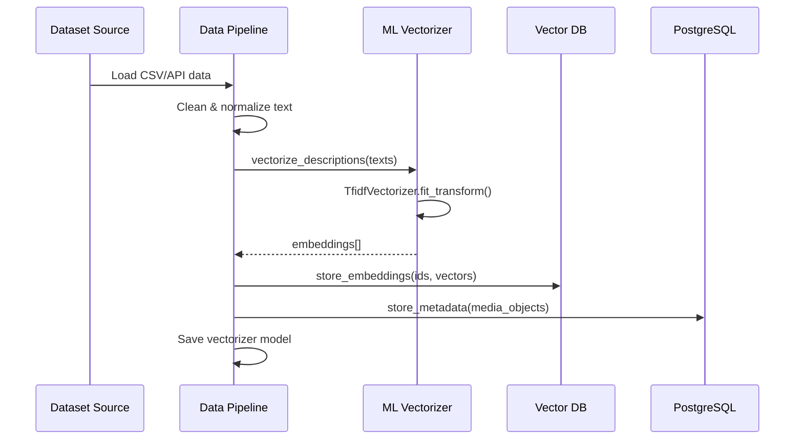
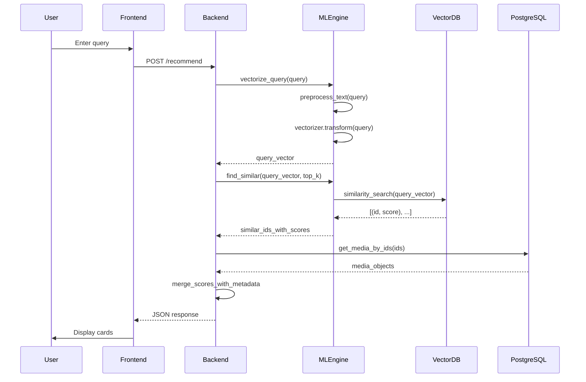

# Design Document: Semantic Media Engine

## Overview

The Semantic Media Engine is a full-stack web application that enables users to discover books and TV shows through natural language queries. Users can type conversational descriptions like "A cozy mystery book set in a coffee shop" or "A fast-paced sci-fi show about time travel" and receive personalized recommendations based on semantic similarity matching. The system uses a content-based recommendation engine that vectorizes plot descriptions and user queries, then calculates similarity scores to return the most relevant matches. The architecture consists of a Next.js frontend with Tailwind CSS, a Python FastAPI backend, PostgreSQL for structured data storage, a vector database for embeddings, and a machine learning pipeline using scikit-learn for text vectorization and similarity computation.

## Architecture



## Sequence Diagrams

### User Query Flow




### Data Pipeline Flow



## Components and Interfaces

### Component 1: Frontend (Next.js)

**Purpose**: Provides user interface for query input and displays recommendations

**Interface**:
```typescript
// Page Component
interface SearchPageProps {}

interface SearchPageState {
  query: string
  loading: boolean
  results: MediaRecommendation[]
  error: string | null
}

interface MediaRecommendation {
  id: string
  title: string
  description: string
  metadata: {
    author?: string
    genre?: string
    year?: number
    rating?: number
  }
  similarity_score: number
}

// API Client
interface RecommendationAPI {
  getRecommendations(query: string): Promise<MediaRecommendation[]>
}
```

**Responsibilities**:
- Capture user input with debouncing
- Manage loading and error states
- Make HTTP requests to FastAPI backend
- Render recommendation cards with smooth animations
- Handle CORS and network errors gracefully


### Component 2: Backend API (FastAPI)

**Purpose**: Orchestrates recommendation requests between frontend and ML engine

**Interface**:
```python
from fastapi import FastAPI
from pydantic import BaseModel
from typing import List, Optional, Dict, Any

class RecommendationRequest(BaseModel):
    query: str
    top_k: Optional[int] = 5
    filters: Optional[Dict[str, Any]] = None

class MediaMetadata(BaseModel):
    author: Optional[str] = None
    genre: Optional[str] = None
    year: Optional[int] = None
    rating: Optional[float] = None

class MediaRecommendation(BaseModel):
    id: str
    title: str
    description: str
    metadata: MediaMetadata
    similarity_score: float

class RecommendationResponse(BaseModel):
    results: List[MediaRecommendation]
    query_time_ms: float

# API Endpoint
@app.post("/recommend", response_model=RecommendationResponse)
async def recommend(request: RecommendationRequest) -> RecommendationResponse:
    pass
```

**Responsibilities**:
- Validate incoming requests
- Configure CORS middleware for Next.js origin
- Call ML engine for similarity computation
- Format and return JSON responses
- Handle errors and timeouts
- Log request metrics


### Component 3: ML Engine

**Purpose**: Performs text vectorization and similarity matching

**Interface**:
```python
from typing import List, Tuple
import numpy as np
from sklearn.feature_extraction.text import TfidfVectorizer
from sklearn.metrics.pairwise import cosine_similarity

class MLEngine:
    def __init__(self, vectorizer_path: str, embeddings_path: str):
        pass
    
    def vectorize_query(self, query: str) -> np.ndarray:
        """Transform query text into embedding vector"""
        pass
    
    def find_similar(
        self, 
        query_vector: np.ndarray, 
        top_k: int = 5,
        similarity_metric: str = "cosine"
    ) -> List[Tuple[str, float]]:
        """
        Find top-k most similar media items
        Returns: List of (media_id, similarity_score) tuples
        """
        pass
    
    def train_vectorizer(self, descriptions: List[str]) -> TfidfVectorizer:
        """Train TF-IDF vectorizer on corpus"""
        pass
    
    def compute_embeddings(self, descriptions: List[str]) -> np.ndarray:
        """Generate embeddings for all descriptions"""
        pass
```

**Responsibilities**:
- Load pre-trained vectorizer model
- Transform user queries into embeddings
- Compute similarity scores (cosine, euclidean, manhattan)
- Return top-k matches with scores
- Cache frequently accessed embeddings


### Component 4: Data Pipeline

**Purpose**: Ingests, processes, and vectorizes media datasets

**Interface**:
```python
from typing import List, Dict, Any
import pandas as pd

class DataPipeline:
    def __init__(self, source_path: str, db_config: Dict[str, Any]):
        pass
    
    def load_dataset(self) -> pd.DataFrame:
        """Load data from Kaggle CSV or API"""
        pass
    
    def clean_text(self, df: pd.DataFrame) -> pd.DataFrame:
        """Normalize and clean text descriptions"""
        pass
    
    def process_and_store(self, df: pd.DataFrame) -> None:
        """Vectorize descriptions and store in databases"""
        pass
    
    def store_embeddings(self, ids: List[str], vectors: np.ndarray) -> None:
        """Store vectors in vector database"""
        pass
    
    def store_metadata(self, df: pd.DataFrame) -> None:
        """Store structured data in PostgreSQL"""
        pass
```

**Responsibilities**:
- Load datasets from Kaggle or APIs
- Clean and normalize text (lowercase, remove special chars, handle nulls)
- Generate embeddings using ML engine
- Store vectors in vector database
- Store metadata in PostgreSQL
- Handle incremental updates for new content


### Component 5: Database Layer

**Purpose**: Manages data persistence for embeddings and metadata

**Interface**:
```python
from typing import List, Dict, Any, Optional

class VectorDatabase:
    """Interface for vector similarity search (e.g., Pinecone, Weaviate, Qdrant)"""
    
    def insert(self, id: str, vector: List[float], metadata: Dict[str, Any]) -> None:
        pass
    
    def search(
        self, 
        query_vector: List[float], 
        top_k: int = 5,
        filter: Optional[Dict[str, Any]] = None
    ) -> List[Dict[str, Any]]:
        pass
    
    def delete(self, id: str) -> None:
        pass

class PostgresDatabase:
    """Interface for structured metadata storage"""
    
    def insert_media(self, media: Dict[str, Any]) -> str:
        pass
    
    def get_media_by_ids(self, ids: List[str]) -> List[Dict[str, Any]]:
        pass
    
    def update_media(self, id: str, updates: Dict[str, Any]) -> None:
        pass
    
    def search_metadata(self, filters: Dict[str, Any]) -> List[Dict[str, Any]]:
        pass
```

**Responsibilities**:
- Vector DB: Store and retrieve embeddings with fast similarity search
- PostgreSQL: Store structured metadata (title, author, genre, year, rating)
- Handle connection pooling and retries
- Provide efficient batch operations
- Support filtering and metadata queries


## Data Models

### Media Item

```typescript
interface MediaItem {
  id: string                    // Unique identifier (UUID)
  title: string                 // Media title
  description: string           // Plot/synopsis description
  media_type: "book" | "tv_show" // Type of media
  metadata: MediaMetadata       // Additional details
  created_at: Date              // Timestamp
  updated_at: Date              // Timestamp
}

interface MediaMetadata {
  author?: string               // For books
  genre?: string                // Genre classification
  year?: number                 // Publication/release year
  rating?: number               // Average rating (0-10)
  director?: string             // For TV shows
  seasons?: number              // For TV shows
  is_latest?: boolean           // Coming soon/latest flag
  thumbnail_url?: string        // Cover image URL
}
```

**Validation Rules**:
- `id` must be valid UUID v4
- `title` must be non-empty string, max 500 characters
- `description` must be non-empty string, max 5000 characters
- `media_type` must be either "book" or "tv_show"
- `year` must be between 1800 and current year + 2
- `rating` must be between 0 and 10 if provided
- `is_latest` defaults to false


### Embedding Vector

```python
class EmbeddingVector:
    """Represents a vectorized media description"""
    media_id: str                # References MediaItem.id
    vector: List[float]          # Dense embedding vector
    dimension: int               # Vector dimensionality (e.g., 512, 768)
    model_version: str           # Vectorizer version for tracking
    created_at: datetime         # Timestamp
```

**Validation Rules**:
- `media_id` must reference existing MediaItem
- `vector` length must match `dimension`
- `dimension` must be positive integer
- All vector values must be finite floats
- `model_version` must match current vectorizer version

### Recommendation Request/Response

```typescript
// Request
interface RecommendationRequest {
  query: string                 // User's natural language query
  top_k?: number                // Number of results (default: 5)
  filters?: {
    media_type?: "book" | "tv_show"
    genre?: string
    min_year?: number
    max_year?: number
    min_rating?: number
    is_latest?: boolean
  }
}

// Response
interface RecommendationResponse {
  results: MediaRecommendation[]
  query_time_ms: number         // Processing time
  query_vector_norm: number     // For debugging
}

interface MediaRecommendation {
  id: string
  title: string
  description: string
  metadata: MediaMetadata
  similarity_score: number      // 0.0 to 1.0
}
```

**Validation Rules**:
- `query` must be non-empty string, max 1000 characters
- `top_k` must be between 1 and 50
- `similarity_score` must be between 0.0 and 1.0
- Results must be sorted by `similarity_score` descending


## Main Algorithm/Workflow



## Key Functions with Formal Specifications

### Function 1: vectorize_query()

```python
def vectorize_query(query: str) -> np.ndarray:
    """Transform user query into embedding vector"""
    pass
```

**Preconditions:**
- `query` is non-null and non-empty string
- `query` length ≤ 1000 characters
- Vectorizer model is loaded and initialized

**Postconditions:**
- Returns numpy array of shape (1, dimension)
- All values in array are finite floats
- Vector norm is non-zero
- No side effects on input query

**Loop Invariants:** N/A (no loops in this function)


### Function 2: find_similar()

```python
def find_similar(
    query_vector: np.ndarray, 
    top_k: int = 5,
    similarity_metric: str = "cosine"
) -> List[Tuple[str, float]]:
    """Find top-k most similar media items"""
    pass
```

**Preconditions:**
- `query_vector` is non-null numpy array with shape (1, dimension)
- `top_k` is positive integer ≤ total number of embeddings
- `similarity_metric` is one of ["cosine", "euclidean", "manhattan"]
- Vector database contains at least one embedding

**Postconditions:**
- Returns list of exactly min(top_k, total_embeddings) tuples
- Each tuple contains (media_id: str, score: float)
- All scores are finite floats in range [0.0, 1.0] for cosine similarity
- Results are sorted by score in descending order
- All media_ids are valid and exist in database
- No duplicate media_ids in results

**Loop Invariants:** N/A (similarity computation delegated to vector database)

### Function 3: preprocess_text()

```python
def preprocess_text(text: str) -> str:
    """Clean and normalize text for vectorization"""
    pass
```

**Preconditions:**
- `text` is non-null string (may be empty)

**Postconditions:**
- Returns cleaned string
- All text is lowercase
- Special characters removed except spaces and alphanumeric
- Multiple consecutive spaces collapsed to single space
- Leading and trailing whitespace removed
- If input is empty or becomes empty after cleaning, returns empty string

**Loop Invariants:**
- For character iteration: All processed characters meet cleaning criteria


### Function 4: compute_similarity()

```python
def compute_similarity(
    query_vector: np.ndarray,
    corpus_vectors: np.ndarray,
    metric: str = "cosine"
) -> np.ndarray:
    """Compute similarity scores between query and corpus"""
    pass
```

**Preconditions:**
- `query_vector` has shape (1, d) where d is dimension
- `corpus_vectors` has shape (n, d) where n is number of items
- Both arrays contain only finite float values
- `metric` is one of ["cosine", "euclidean", "manhattan"]
- For cosine similarity: vectors have non-zero norm

**Postconditions:**
- Returns numpy array of shape (n,) containing similarity scores
- All scores are finite floats
- For cosine: scores in range [-1.0, 1.0], typically [0.0, 1.0] for text
- For euclidean/manhattan: scores are non-negative distances
- No mutations to input arrays

**Loop Invariants:** N/A (vectorized operations via numpy/sklearn)

### Function 5: train_vectorizer()

```python
def train_vectorizer(descriptions: List[str]) -> TfidfVectorizer:
    """Train TF-IDF vectorizer on corpus"""
    pass
```

**Preconditions:**
- `descriptions` is non-empty list of strings
- Each description is non-null (may be empty string)
- At least one description contains non-whitespace text

**Postconditions:**
- Returns fitted TfidfVectorizer instance
- Vectorizer vocabulary is non-empty
- Vectorizer can transform new text into vectors
- Vectorizer parameters are set (max_features, ngram_range, etc.)
- No side effects on input descriptions

**Loop Invariants:**
- For corpus iteration: All processed documents contribute to vocabulary


## Algorithmic Pseudocode

### Main Recommendation Algorithm

```python
def get_recommendations(query: str, top_k: int = 5, filters: dict = None) -> List[dict]:
    """
    Main algorithm for generating recommendations
    
    INPUT: query (user's natural language search string)
           top_k (number of recommendations to return)
           filters (optional metadata filters)
    OUTPUT: List of recommendation dictionaries with scores
    """
    # Step 1: Validate and preprocess input
    assert len(query) > 0 and len(query) <= 1000, "Query must be 1-1000 characters"
    assert 1 <= top_k <= 50, "top_k must be between 1 and 50"
    
    cleaned_query = preprocess_text(query)
    assert len(cleaned_query) > 0, "Query must contain valid text after preprocessing"
    
    # Step 2: Vectorize query
    query_vector = vectorize_query(cleaned_query)
    assert query_vector.shape[0] == 1, "Query vector must have shape (1, d)"
    assert np.all(np.isfinite(query_vector)), "Query vector must contain finite values"
    
    # Step 3: Find similar items in vector database
    similar_items = find_similar(query_vector, top_k, similarity_metric="cosine")
    assert len(similar_items) <= top_k, "Results must not exceed top_k"
    assert all(0.0 <= score <= 1.0 for _, score in similar_items), "Scores must be in [0, 1]"
    
    # Step 4: Retrieve metadata from PostgreSQL
    media_ids = [item_id for item_id, _ in similar_items]
    media_objects = get_media_by_ids(media_ids)
    assert len(media_objects) == len(media_ids), "All media IDs must exist"
    
    # Step 5: Apply optional filters
    if filters:
        media_objects = apply_filters(media_objects, filters)
    
    # Step 6: Merge scores with metadata
    results = []
    for (media_id, score), media in zip(similar_items, media_objects):
        assert media['id'] == media_id, "Media ID must match"
        results.append({
            'id': media_id,
            'title': media['title'],
            'description': media['description'],
            'metadata': media['metadata'],
            'similarity_score': score
        })
    
    # Step 7: Sort by score descending (should already be sorted)
    results.sort(key=lambda x: x['similarity_score'], reverse=True)
    
    assert all(results[i]['similarity_score'] >= results[i+1]['similarity_score'] 
               for i in range(len(results)-1)), "Results must be sorted by score"
    
    return results
```

**Preconditions:**
- query is non-empty string with length ≤ 1000
- top_k is integer in range [1, 50]
- filters is None or valid dictionary with recognized keys
- Vectorizer model is loaded
- Vector database is accessible and contains embeddings
- PostgreSQL database is accessible

**Postconditions:**
- Returns list of recommendation dictionaries
- List length ≤ min(top_k, total_matching_items)
- All recommendations have similarity_score in [0.0, 1.0]
- Results sorted by similarity_score descending
- All required fields present in each recommendation
- No duplicate media items in results

**Loop Invariants:**
- For filter iteration: All retained items satisfy filter criteria
- For merge iteration: All processed items have matching IDs and valid scores


### Data Pipeline Processing Algorithm

```python
def process_dataset(source_path: str, batch_size: int = 1000) -> None:
    """
    Process and vectorize media dataset
    
    INPUT: source_path (path to dataset CSV or API endpoint)
           batch_size (number of items to process per batch)
    OUTPUT: None (side effects: stores data in databases)
    """
    # Step 1: Load dataset
    df = load_dataset(source_path)
    assert len(df) > 0, "Dataset must contain at least one item"
    assert 'description' in df.columns, "Dataset must have description column"
    
    # Step 2: Clean and validate data
    df = clean_text(df)
    df = df.dropna(subset=['title', 'description'])
    assert len(df) > 0, "Dataset must have valid items after cleaning"
    
    # Step 3: Train or load vectorizer
    if not vectorizer_exists():
        descriptions = df['description'].tolist()
        vectorizer = train_vectorizer(descriptions)
        save_vectorizer(vectorizer)
    else:
        vectorizer = load_vectorizer()
    
    # Step 4: Process in batches
    total_batches = (len(df) + batch_size - 1) // batch_size
    
    for batch_idx in range(total_batches):
        # Loop invariant: All previous batches successfully processed and stored
        start_idx = batch_idx * batch_size
        end_idx = min(start_idx + batch_size, len(df))
        batch_df = df.iloc[start_idx:end_idx]
        
        # Step 4a: Generate embeddings for batch
        descriptions = batch_df['description'].tolist()
        embeddings = vectorizer.transform(descriptions).toarray()
        assert embeddings.shape[0] == len(batch_df), "One embedding per item"
        
        # Step 4b: Store embeddings in vector database
        for idx, (_, row) in enumerate(batch_df.iterrows()):
            media_id = row['id']
            vector = embeddings[idx].tolist()
            store_embedding(media_id, vector)
        
        # Step 4c: Store metadata in PostgreSQL
        batch_records = batch_df.to_dict('records')
        store_metadata_batch(batch_records)
        
        # Verify batch processing
        assert all(embedding_exists(row['id']) for _, row in batch_df.iterrows()), \
               "All embeddings must be stored"
        assert all(metadata_exists(row['id']) for _, row in batch_df.iterrows()), \
               "All metadata must be stored"
    
    # Final verification
    total_stored = count_stored_items()
    assert total_stored == len(df), "All items must be stored"
```

**Preconditions:**
- source_path points to valid dataset file or API
- batch_size is positive integer
- Vector database is accessible and initialized
- PostgreSQL database is accessible and initialized
- Sufficient storage space available

**Postconditions:**
- All valid items from dataset are stored
- Each item has embedding in vector database
- Each item has metadata in PostgreSQL
- Vectorizer model is saved to disk
- No partial batches left unprocessed

**Loop Invariants:**
- All batches processed before current batch are fully stored
- All embeddings in processed batches are accessible
- All metadata in processed batches is accessible
- No data corruption in previously processed batches


### Text Preprocessing Algorithm

```python
def preprocess_text(text: str) -> str:
    """
    Clean and normalize text for vectorization
    
   

## Correctness Properties

*A property is a characteristic or behavior that should hold true across all valid executions of a system—essentially, a formal statement about what the system should do. Properties serve as the bridge between human-readable specifications and machine-verifiable correctness guarantees.*

### Property 1: Query Validation Rejects Invalid Inputs

*For any* query string, if the query is empty or exceeds 1000 characters, the Backend should reject it and return an error response with a descriptive message.

**Validates: Requirements 1.2, 1.3, 12.1**

### Property 2: Text Preprocessing Consistency

*For any* text input (query or description), the ML_Engine should apply identical preprocessing transformations: lowercase conversion, special character removal (except spaces and alphanumeric), whitespace normalization, and trimming.

**Validates: Requirements 2.1, 19.1, 19.2, 19.3, 19.4, 19.5**

### Property 3: Vector Validity

*For any* generated embedding vector, all values must be finite floats and the vector must have non-zero norm.

**Validates: Requirements 2.3, 2.4, 9.3**

### Property 4: Vectorizer Round-Trip

*For any* trained vectorizer, saving it to disk and then loading it back should produce a vectorizer that generates identical embeddings for the same input text.

**Validates: Requirements 8.4, 8.5**

### Property 5: Similarity Score Range

*For any* similarity computation using cosine similarity, all returned scores must be in the range 0.0 to 1.0.

**Validates: Requirements 3.3**

### Property 6: Results Sorted by Score

*For any* recommendation result set, items must be sorted by similarity_score in descending order.

**Validates: Requirements 3.4, 5.4**

### Property 7: Top-K Constraint

*For any* recommendation request with top_k parameter, the system should return at most min(top_k, total_matching_items) unique results, where top_k is validated to be between 1 and 50.

**Validates: Requirements 3.5, 20.5**

### Property 8: Response Completeness

*For any* successful recommendation response, it must include a results array and query_time_ms field, and each recommendation must contain id, title, description, metadata, and similarity_score.

**Validates: Requirements 5.1, 5.2, 5.3, 4.2**

### Property 9: Metadata Retrieval Completeness

*For any* list of valid media IDs, retrieving metadata from PostgreSQL should return complete metadata objects for all IDs.

**Validates: Requirements 4.1, 4.4**

### Property 10: Dataset Validation

*For any* loaded dataset, the Data_Pipeline should verify that required columns (title, description) are present and remove rows with null or empty values in these fields.

**Validates: Requirements 7.2, 7.4**

### Property 11: Batch Processing Completeness

*For any* dataset processed in batches, after all batches complete, the total count of stored items (both embeddings and metadata) must equal the count of valid items in the cleaned dataset.

**Validates: Requirements 11.4, 17.1**

### Property 12: Embedding Dimensionality Consistency

*For any* set of embeddings stored in the Vector_DB, all embeddings must have the same dimensionality matching the vectorizer's output dimension.

**Validates: Requirements 9.2**

### Property 13: Metadata Validation

*For any* media item stored in PostgreSQL, the title must be non-empty and at most 500 characters, the description must be non-empty and at most 5000 characters, and media_type must be either "book" or "tv_show".

**Validates: Requirements 10.3, 10.4, 10.5**

### Property 14: Parameter Validation

*For any* request parameters, the system should validate that top_k is between 1 and 50, year is between 1800 and current_year + 2, and rating is between 0 and 10.

**Validates: Requirements 12.2, 12.3, 12.4**

### Property 15: Filter Application

*For any* recommendation request with filters, all returned results must satisfy the filter criteria (media_type, genre, year range, min_rating).

**Validates: Requirements 15.1, 15.2, 15.3, 15.4, 15.5**

### Property 16: Result Uniqueness

*For any* recommendation result set, no media ID should appear more than once, and if the Vector_DB returns duplicates, the ML_Engine should deduplicate them keeping the entry with the highest similarity score.

**Validates: Requirements 20.1, 20.2, 20.3, 20.4**

### Property 17: Referential Integrity

*For any* media item in the system, if an embedding exists in Vector_DB, then corresponding metadata must exist in PostgreSQL, and vice versa.

**Validates: Requirements 17.2, 17.3, 17.4**

### Property 18: Model Version Tracking

*For any* stored embedding, it must include the model_version in its metadata, and when loading a vectorizer, the system should verify the version matches the expected version.

**Validates: Requirements 18.1, 18.3, 18.5**

### Property 19: Error Handling with Appropriate Status Codes

*For any* error condition, the Backend should return an appropriate HTTP status code (400 for validation errors, 503 for service unavailability) and log the error details.

**Validates: Requirements 13.2, 13.3**

### Property 20: Request Logging

*For any* request to the /recommend endpoint, the Backend should log request metrics including timestamp, query length, and processing time.

**Validates: Requirements 16.3, 16.4, 16.5**
