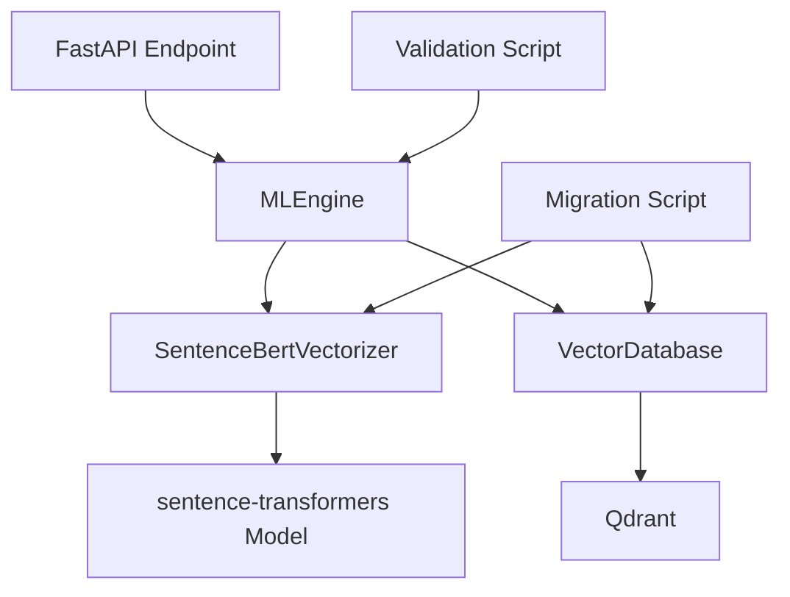

# Design Document: Sentence-BERT Upgrade

## Overview

This design document specifies the technical approach for upgrading the VibeCheck Finder semantic search system from TF-IDF sparse vectorization to Sentence-BERT dense embeddings. The upgrade will enable true semantic understanding of search queries while maintaining API backward compatibility and system performance.

### Current System Architecture

The existing system uses:
- **TF-IDF Vectorizer**: scikit-learn's TfidfVectorizer producing sparse ~10,000-dimensional vectors
- **Cosine Similarity**: Similarity scores typically 15-30% for good matches
- **File-based Storage**: Pickle files for vectorizer and embeddings
- **MLEngine Class**: Unified interface for vectorization and similarity search
- **Qdrant Vector Database**: Optional vector storage (currently configured for 512-dimensional vectors)

### Target System Architecture

The upgraded system will use:
- **Sentence-BERT Model**: sentence-transformers library with all-MiniLM-L6-v2 pretrained model
- **Dense Embeddings**: 384-dimensional float32 vectors
- **Enhanced Similarity**: Cosine similarity scores of 60-80% for semantically relevant matches
- **Backward Compatible API**: No changes to FastAPI endpoints or response formats
- **Migration Strategy**: Safe upgrade path with rollback capability

### Design Goals

1. **Semantic Understanding**: Enable conceptual matching beyond exact word overlap
2. **Backward Compatibility**: Maintain existing API contracts and response formats
3. **Performance**: Keep search latency under 200ms
4. **Safe Migration**: Provide rollback capability and validation tools
5. **Code Reusability**: Minimize changes to existing MLEngine interface

## Architecture

### Component Overview



### Key Architectural Changes

1. **New SentenceBertVectorizer Class**
   - Wraps sentence-transformers SentenceTransformer model
   - Implements same interface as TF-IDF vectorizer for compatibility
   - Handles model loading, caching, and encoding

2. **Updated MLEngine Class**
   - Add vectorizer_type parameter ("tfidf" or "sbert")
   - Maintain existing method signatures
   - Route to appropriate vectorizer based on type

3. **Vector Database Configuration**
   - Update Qdrant collection to use 384-dimensional vectors
   - Maintain cosine similarity distance metric
   - Support migration from old to new collection

4. **Migration Infrastructure**
   - Standalone migration script for batch embedding regeneration
   - Progress tracking and error handling
   - Backup and rollback mechanisms

### Data Flow

**Query Processing Flow:**
1. User submits search query via FastAPI endpoint
2. MLEngine.vectorize_query() preprocesses and encodes query using Sentence-BERT
3. Query vector (384-dim) passed to VectorDatabase.search()
4. Qdrant performs cosine similarity search
5. Top-k results returned with similarity scores
6. FastAPI formats and returns results

**Embedding Generation Flow:**
1. Migration script loads all media descriptions from PostgreSQL
2. Batch processing: descriptions grouped for efficient encoding
3. SentenceBertVectorizer.encode() generates 384-dim embeddings
4. Embeddings stored in Qdrant with metadata
5. Validation checks embedding quality and dimensionality

## Components and Interfaces

### SentenceBertVectorizer Class

```python
class SentenceBertVectorizer:
    """
    Sentence-BERT vectorizer for semantic text embeddings.
    
    Wraps the sentence-transformers library to provide dense embeddings
    with the same interface as the TF-IDF vectorizer for compatibility.
    """
    
    def __init__(
        self,
        model_name: str = "all-MiniLM-L6-v2",
        cache_folder: Optional[str] = None,
        device: Optional[str] = None
    ):
        """
        Initialize Sentence-BERT model.
        
        Args:
            model_name: Pretrained model name from sentence-transformers
            cache_folder: Directory to cache model weights
            device: Device to run model on ('cpu', 'cuda', or None for auto)
        """
        
    def encode(
        self,
        texts: Union[str, List[str]],
        batch_size: int = 32,
        show_progress_bar: bool = False,
        normalize_embeddings: bool = True
    ) -> np.ndarray:
        """
        Encode text(s) into embedding vector(s).
        
        Args:
            texts: Single text string or list of texts
            batch_size: Batch size for encoding
            show_progress_bar: Whether to show progress bar
            normalize_embeddings: Whether to L2-normalize embeddings
        
        Returns:
            numpy array of shape (n, 384) for n texts
        """
        
    def get_embedding_dimension(self) -> int:
        """Get the dimensionality of embeddings (384)."""
        
    def save(self, path: str) -> None:
        """Save model configuration and metadata."""
        
    @classmethod
    def load(cls, path: str) -> "SentenceBertVectorizer":
        """Load model from saved configuration."""
```

### Updated MLEngine Class

```python
class MLEngine:
    """
    Machine Learning Engine supporting multiple vectorization backends.
    """
    
    def __init__(
        self,
        vectorizer_type: str = "sbert",  # "tfidf" or "sbert"
        vectorizer_path: str = "backend/models",
        embeddings_path: str = "backend/embeddings",
        model_name: Optional[str] = None  # For sbert: model name
    ):
        """
        Initialize ML Engine with specified vectorizer type.
        
        Args:
            vectorizer_type: Type of vectorizer ("tfidf" or "sbert")
            vectorizer_path: Path to vectorizer models
            embeddings_path: Path to embeddings storage
            model_name: Model name for sentence-transformers (if sbert)
        """
        
    def vectorize_query(self, query: str) -> np.ndarray:
        """
        Transform query into embedding vector.
        
        Maintains same interface regardless of vectorizer type.
        Returns shape (1, dimension) where dimension is 384 for sbert.
        """
        
    def compute_embeddings(
        self,
        descriptions: List[str],
        media_ids: List[str],
        batch_size: int = 32
    ) -> np.ndarray:
        """
        Generate embeddings for media descriptions.
        
        Args:
            descriptions: List of media descriptions
            media_ids: Corresponding media IDs
            batch_size: Batch size for encoding (sbert only)
        
        Returns:
            numpy array of shape (n, dimension)
        """
```

### VectorDatabase Updates

```python
class VectorDatabase:
    """
    Updated to support 384-dimensional Sentence-BERT embeddings.
    """
    
    def __init__(
        self,
        host: str = "localhost",
        port: int = 6333,
        collection_name: str = "media_embeddings_sbert",  # New collection
        vector_size: int = 384,  # Updated from 512
        distance_metric: Distance = Distance.COSINE,
    ):
        """Initialize with 384-dimensional vector support."""
```

### Migration Script Interface

```python
def migrate_to_sbert(
    postgres_conn_string: str,
    qdrant_host: str = "localhost",
    qdrant_port: int = 6333,
    batch_size: int = 32,
    backup: bool = True,
    dry_run: bool = False
) -> Dict[str, Any]:
    """
    Migrate all embeddings from TF-IDF to Sentence-BERT.
    
    Args:
        postgres_conn_string: PostgreSQL connection string
        qdrant_host: Qdrant server host
        qdrant_port: Qdrant server port
        batch_size: Batch size for encoding
        backup: Whether to backup existing embeddings
        dry_run: If True, validate without writing
    
    Returns:
        Migration report with statistics and any errors
    """
```

### Validation Script Interface

```python
def validate_embeddings(
    test_queries: List[str],
    qdrant_host: str = "localhost",
    qdrant_port: int = 6333,
    compare_tfidf: bool = True
) -> Dict[str, Any]:
    """
    Validate Sentence-BERT embedding quality.
    
    Args:
        test_queries: List of test queries to evaluate
        qdrant_host: Qdrant server host
        qdrant_port: Qdrant server port
        compare_tfidf: Whether to compare with TF-IDF results
    
    Returns:
        Validation report with quality metrics
    """
```

## Data Models

### Embedding Storage Format

**Qdrant Point Structure:**
```python
{
    "id": "media_123",  # Media item unique identifier
    "vector": [0.123, -0.456, ...],  # 384-dimensional float32 array
    "payload": {
        "media_id": "media_123",
        "title": "Movie Title",
        "description": "Original description text",
        "model_version": "all-MiniLM-L6-v2",
        "embedding_date": "2024-01-15T10:30:00Z",
        "vectorizer_type": "sbert"
    }
}
```

### Model Metadata Format

**Saved in `backend/models/sbert_metadata.json`:**
```json
{
    "model_name": "all-MiniLM-L6-v2",
    "embedding_dimension": 384,
    "vectorizer_type": "sbert",
    "created_at": "2024-01-15T10:30:00Z",
    "library_version": "2.2.2",
    "total_embeddings": 5832,
    "normalization": true
}
```

### Migration Report Format

```python
{
    "status": "completed",  # "completed", "failed", "partial"
    "total_items": 5832,
    "successful": 5832,
    "failed": 0,
    "duration_seconds": 45.2,
    "errors": [],  # List of error messages
    "backup_location": "backend/backups/tfidf_20240115_103000",
    "new_collection": "media_embeddings_sbert",
    "old_collection": "media_embeddings"
}
```

### Validation Report Format

```python
{
    "embedding_checks": {
        "total_embeddings": 5832,
        "correct_dimension": 5832,
        "all_finite": True,
        "dimension_errors": []
    },
    "query_comparisons": [
        {
            "query": "little girl",
            "tfidf_top_score": 0.28,
            "sbert_top_score": 0.72,
            "improvement": 2.57,
            "tfidf_results": [...],
            "sbert_results": [...]
        }
    ],
    "semantic_tests": [
        {
            "query": "romantic comedy",
            "expected_concepts": ["love", "humor", "romance"],
            "found_concepts": True,
            "avg_score": 0.68
        }
    ]
}
```


## Correctness Properties

*A property is a characteristic or behavior that should hold true across all valid executions of a system—essentially, a formal statement about what the system should do. Properties serve as the bridge between human-readable specifications and machine-verifiable correctness guarantees.*

### Property 1: Embedding Dimensionality Invariant

*For any* valid text input (query or media description), the Sentence-BERT model SHALL produce an embedding vector with exactly 384 dimensions.

**Validates: Requirements 1.4, 2.2, 2.3, 2.5, 3.3, 4.1, 9.3**

**Rationale:** This is a fundamental invariant of the Sentence-BERT all-MiniLM-L6-v2 model. All embeddings must have consistent dimensionality for vector operations (cosine similarity, storage, retrieval) to function correctly. This property ensures that regardless of input text length, content, or language, the output dimensionality remains constant.

### Property 2: Finite Embedding Values

*For any* generated embedding vector, all 384 values SHALL be finite floating-point numbers (no NaN or infinity values).

**Validates: Requirements 9.4**

**Rationale:** Non-finite values (NaN or infinity) would break similarity computations and indicate model or input processing errors. This property ensures numerical stability across all embeddings.

### Property 3: Encoding Idempotence

*For any* text input, encoding the same text multiple times SHALL produce identical embedding vectors (element-wise equality within floating-point precision).

**Validates: Requirements 9.5**

**Rationale:** The encoding function should be deterministic and stateless. Given the same input, it must always produce the same output. This is critical for reproducibility, caching, and debugging. Mathematically: encode(text) = encode(encode_metadata(text)) where encode_metadata represents any metadata operations that don't change the text content.

### Property 4: Storage Round-Trip Preservation

*For any* embedding vector, storing it in the Vector Database and then retrieving it SHALL return a vector that is element-wise equal to the original (within floating-point precision).

**Validates: Requirements 4.4**

**Rationale:** This is a classic round-trip property ensuring data integrity through the storage layer. The database must preserve the exact numerical values without corruption, truncation, or transformation. This is essential for maintaining search quality and reproducibility.

### Property 5: ID Association Preservation

*For any* media item with unique identifier ID, storing its embedding in the Vector Database SHALL maintain the association such that retrieving by ID returns the correct embedding, and searching with that embedding returns the correct ID.

**Validates: Requirements 4.3**

**Rationale:** The mapping between media IDs and embeddings must be bijective and preserved through storage operations. This ensures search results correctly identify the media items they represent.

### Property 6: Metadata Preservation During Migration

*For any* media item, its metadata (title, description, genre, etc.) before migration SHALL be identical to its metadata after migration completes successfully.

**Validates: Requirements 3.5**

**Rationale:** Migration should only change the embedding vectors, not the underlying media data. This invariant ensures data integrity during the upgrade process. Only the vectorizer_type and embedding-related fields should change.

### Property 7: Results Sorted by Similarity Score

*For any* search query, the returned list of media items SHALL be sorted in descending order by similarity score, where score[i] >= score[i+1] for all adjacent pairs.

**Validates: Requirements 5.4**

**Rationale:** Users expect the most relevant results first. This property ensures the ranking is consistent and correct, which is fundamental to search quality. This should hold regardless of the vectorization method used.

### Property 8: Semantic Improvement Over TF-IDF

*For any* search query with semantically similar results in the dataset, the average similarity score of the top-k results using Sentence-BERT SHALL be greater than or equal to the average similarity score using TF-IDF for the same query.

**Validates: Requirements 6.5**

**Rationale:** This is a metamorphic property that validates the core value proposition of the upgrade. Sentence-BERT should provide better semantic matching than TF-IDF. While individual scores may vary, the average quality should improve. This property allows us to validate the upgrade's effectiveness without knowing the "correct" results.

### Property 9: Migration Rollback Round-Trip

*For any* system state before migration, executing migration followed by rollback SHALL restore the system to a functionally equivalent state where search results using TF-IDF match the original results.

**Validates: Requirements 8.5**

**Rationale:** This round-trip property ensures the rollback mechanism works correctly. After rollback, the system should behave as if the migration never occurred. This is critical for safe deployment and risk mitigation.

## Error Handling

### Model Loading Errors

**Scenario:** Sentence-BERT model fails to download or load
- **Detection:** Catch exceptions during SentenceTransformer initialization
- **Response:** Log detailed error with model name and cache path, return HTTP 503 Service Unavailable
- **Recovery:** Retry with exponential backoff, fall back to cached model if available
- **User Message:** "Search service temporarily unavailable. Please try again in a few moments."

### Vector Database Errors

**Scenario:** Qdrant connection fails or times out
- **Detection:** Catch connection exceptions in VectorDatabase methods
- **Response:** Log error with connection details, return HTTP 503 Service Unavailable
- **Recovery:** Implement connection pooling with automatic reconnection
- **User Message:** "Search service temporarily unavailable. Please try again shortly."

### Input Validation Errors

**Scenario:** Empty query or invalid input
- **Detection:** Validate query before processing
- **Response:** Return HTTP 400 Bad Request with descriptive message
- **User Message:** "Search query cannot be empty. Please enter a search term."

**Scenario:** Query exceeds 512 tokens
- **Detection:** Check token count before encoding
- **Response:** Truncate to first 512 tokens, log warning, process normally
- **User Message:** None (transparent truncation)

### Embedding Generation Errors

**Scenario:** Text encoding produces invalid embeddings (NaN, wrong dimension)
- **Detection:** Validate embedding after generation
- **Response:** Log error with input text (truncated), raise ValueError
- **Recovery:** Skip problematic item during migration, continue with others
- **Migration Report:** Include failed items with error details

### Migration Errors

**Scenario:** Migration fails partway through
- **Detection:** Track progress and catch exceptions
- **Response:** Log detailed error report, preserve partial progress
- **Recovery:** Support resume from last successful batch
- **Rollback:** Restore from backup if available

**Scenario:** Insufficient disk space or memory
- **Detection:** Monitor resources during migration
- **Response:** Fail gracefully with clear error message
- **Prevention:** Check available resources before starting migration

### Edge Cases

**Special Characters and Non-ASCII Text:**
- Sentence-BERT handles Unicode natively
- No special preprocessing required
- Test with emoji, CJK characters, accented characters

**Very Short Text:**
- Minimum: empty string after preprocessing
- Handle: Return error for empty, process normally for 1+ characters
- Sentence-BERT works well with short text

**Very Long Text:**
- Maximum: 512 tokens (model limit)
- Handle: Truncate to first 512 tokens
- Log warning for truncated inputs

**Duplicate Media Items:**
- Detection: Check for duplicate IDs during migration
- Handle: Keep most recent version, log warning
- Ensure uniqueness in vector database

## Testing Strategy

### Dual Testing Approach

The testing strategy employs both unit tests and property-based tests to ensure comprehensive coverage:

**Unit Tests** focus on:
- Specific example queries (e.g., "little girl", "romantic comedy", "space adventure")
- Edge cases (empty queries, very long queries, special characters)
- Error conditions (model loading failure, database unavailability)
- Integration points (API endpoints, database connections)
- Migration script functionality

**Property-Based Tests** focus on:
- Universal properties that hold for all inputs
- Comprehensive input coverage through randomization
- Invariants (dimensionality, finite values)
- Round-trip properties (storage, rollback)
- Metamorphic properties (semantic improvement)

### Property-Based Testing Configuration

**Library:** Use `hypothesis` for Python property-based testing

**Configuration:**
- Minimum 100 iterations per property test (due to randomization)
- Each test tagged with: **Feature: sentence-bert-upgrade, Property {number}: {property_text}**
- Use appropriate strategies for text generation (including Unicode, special characters, various lengths)

**Example Test Structure:**
```python
from hypothesis import given, strategies as st
import pytest

@given(text=st.text(min_size=1, max_size=1000))
def test_property_1_embedding_dimensionality(text):
    """
    Feature: sentence-bert-upgrade, Property 1: Embedding Dimensionality Invariant
    
    For any valid text input, the Sentence-BERT model SHALL produce 
    an embedding vector with exactly 384 dimensions.
    """
    vectorizer = SentenceBertVectorizer()
    embedding = vectorizer.encode(text)
    assert embedding.shape == (1, 384), f"Expected shape (1, 384), got {embedding.shape}"
```

### Unit Test Coverage

**Model Initialization Tests:**
- Test successful model loading with default parameters
- Test model loading with custom cache folder
- Test model loading failure handling
- Verify model is cached in memory after first load

**Encoding Tests:**
- Test encoding single text string
- Test encoding batch of texts
- Test encoding with normalization enabled/disabled
- Test specific example queries from requirements (6.1, 6.2, 6.3)

**Vector Database Tests:**
- Test storing and retrieving embeddings
- Test similarity search returns correct results
- Test handling of duplicate IDs
- Test error handling for connection failures

**Migration Tests:**
- Test migration script processes all items
- Test migration preserves metadata
- Test migration handles errors gracefully
- Test backup creation before migration
- Test rollback restores original state

**API Compatibility Tests:**
- Test request format unchanged
- Test response format unchanged
- Test pagination, filtering, sorting still work
- Verify embedding dimension in responses is 384

### Integration Tests

**End-to-End Search Flow:**
1. Submit query via API endpoint
2. Verify query is encoded with Sentence-BERT
3. Verify search returns results
4. Verify results are ranked by score
5. Verify response format matches specification

**Migration Integration:**
1. Run migration script on test dataset
2. Verify all embeddings generated
3. Verify search works with new embeddings
4. Run rollback
5. Verify search works with old embeddings

### Performance Tests

While not correctness properties, performance tests validate requirements 7.1-7.4:

**Query Encoding Performance:**
- Measure encoding time for various query lengths
- Target: < 50ms per query
- Test with cold start and warm cache

**Search Performance:**
- Measure end-to-end search time
- Target: < 200ms for top-10 results
- Test with full 5,832 item dataset

**Migration Performance:**
- Measure time to migrate all 5,832 items
- Monitor memory usage during migration
- Test batch size optimization

### Validation Tests

**Embedding Quality Validation:**
- Compare TF-IDF vs Sentence-BERT scores for test queries
- Verify Sentence-BERT produces higher scores for semantic matches
- Test semantic understanding with synonym queries
- Generate validation report with metrics

**Semantic Understanding Tests:**
- Query: "little girl" → Expect results about young girls, children, daughters
- Query: "romantic comedy" → Expect results about love stories with humor
- Query: "space adventure" → Expect results about sci-fi exploration
- Verify scores are in 60-80% range for good matches

### Test Data

**Test Queries:**
- Semantic equivalents: "little girl" / "young girl" / "small child"
- Compound concepts: "romantic comedy" / "funny love story"
- Domain-specific: "space adventure" / "sci-fi exploration"
- Edge cases: "", "a", very long text, special characters, emoji

**Test Media Items:**
- Use subset of Netflix dataset for unit tests (100 items)
- Use full dataset for integration tests (5,832 items)
- Create synthetic test cases for edge cases

### Continuous Testing

**Pre-commit Hooks:**
- Run unit tests and fast property tests
- Verify code formatting and linting

**CI/CD Pipeline:**
- Run full unit test suite
- Run property-based tests with 100+ iterations
- Run integration tests
- Generate coverage report (target: >80%)

**Deployment Validation:**
- Run validation script comparing TF-IDF vs Sentence-BERT
- Verify embedding quality metrics
- Monitor search performance in production
- Set up alerts for errors or performance degradation

